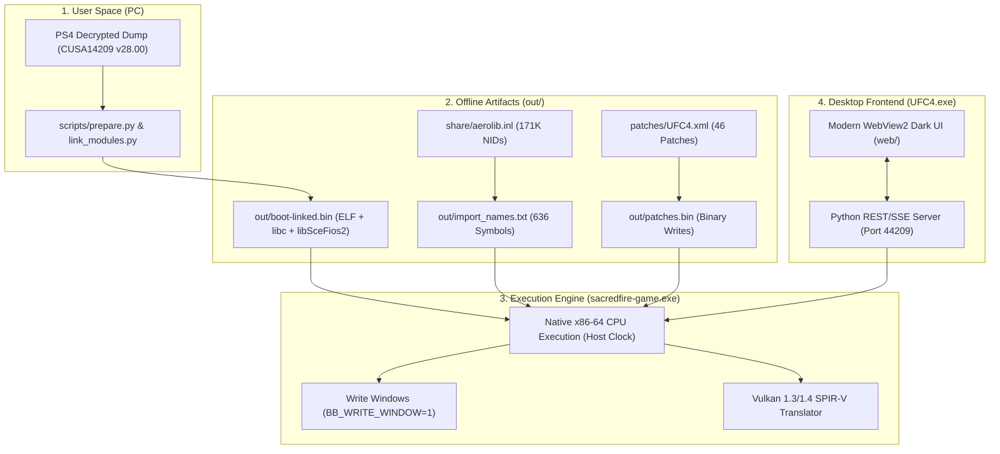

# 🥊 EA SPORTS UFC 4 — Developer & AI Architecture Guidelines

Welcome to the comprehensive technical documentation for the **EA SPORTS UFC 4 Windows Native Port** (`CUSA14209`, update `v28.00`).

This documentation serves as the single source of truth for human developers and AI assistants. It explains the end-to-end architecture, binary preparation pipeline, engine patches, GPU memory translation, and modern launcher subsystems.

---

## 🗺️ Documentation Map

| Chapter | Document | Description |
| :--- | :--- | :--- |
| **01** | [Architecture & Runtime](01_ARCHITECTURE.md) | Native x86-64 execution, Orbis OS HLE/LLE runtime, Vulkan 1.3/1.4 translation stack. |
| **02** | [Binary Pipeline](02_BINARY_PIPELINE.md) | Offline ELF preparation, module linking, aerolib.inl symbols, and import binding. |
| **03** | [EA Ignite Engine & Memory](03_IGNITE_ENGINE_AND_MEMORY.md) | Write Windows, dynamic buffer coherence, preventing vertex explosions and stutter. |
| **04** | [Stability & Patches](04_STABILITY_AND_PATCHES.md) | 46+ Dual-Baked XML patches, DirtySDK offline bypasses, backpressure & null-safety. |
| **05** | [AAA WebView2 Launcher](05_AAA_WEBVIEW2_LAUNCHER.md) | C++ Win32 host, embedded WebView2, dark UI, REST API, and real-time SSE log streaming. |
| **06** | [Packaging & Releases](06_PACKAGING_AND_RELEASES.md) | Separation of clean source code in Git from prebuilt release bundles. |
| **07** | [Troubleshooting & Known Bugs](07_TROUBLESHOOTING_AND_FAQ.md) | Issue #4534 (Pro freeze), Issue #4375 (black screen), Issue #4944 (vertex explosion), audio & saves. |

---

## ⚡ High-Level Execution Pipeline

---

## 🎯 Key Guiding Principles
1. **Zero CPU Emulation:** PS4 Jaguar is x86-64. The game's machine code executes directly on the host CPU.
2. **Strict Copyright Compliance:** No copyrighted game assets, dumps, or proprietary Sony keys are ever committed to Git.
3. **Reproducibility:** Any build can be reconstructed from clean source code plus an official PS4 game dump.
